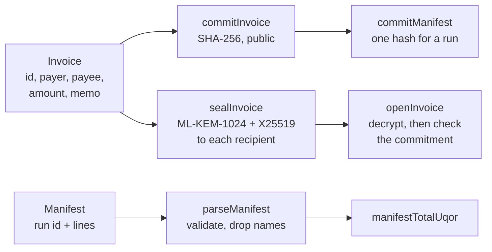

<h1 align="center">Veilbooks Core</h1>

<p align="center">
  <b>Shared building blocks for private business payments on QoreChain.</b><br>
  Sealed invoices, public commitments, payment manifests and post-quantum key registration.
</p>

<p align="center">
  
  
  
  
  
</p>

---

## Contents

- [Overview](#overview)
- [How it works](#how-it-works)
- [Features](#features)
- [Quick start](#quick-start)
- [API](#api)
- [Behaviour](#behaviour)
- [Project structure](#project-structure)
- [Limitations](#limitations)
- [The Veilbooks suite](#the-veilbooks-suite)

## Overview

Veilbooks Core is a small TypeScript library with the cryptographic building blocks shared by the other Veilbooks projects. It is **browser safe**: hashing uses `@noble/hashes` and nothing needs Node-only modules, so the same code runs in Veilbooks Desk in the browser and in scripts.

It supports a project built for the QoreChain "Build Before Q-Day" developer fest. It is not entered as a track of its own.

## How it works



- An invoice is canonicalised and hashed into a **commitment** that reveals nothing about the amount.
- `sealInvoice` encrypts the invoice to several recipients. The invoice id is authenticated data, so an envelope cannot be replayed under another id.
- `openInvoice` decrypts and re-checks the commitment, so a tampered or swapped envelope is refused.
- A **manifest** is the list of payments in a run. `parseManifest` validates one coming from Desk before Rail reads it.

## Features

- **Sealed invoices**: `sealInvoice` and `openInvoice` encrypt an invoice to several recipients and verify its commitment when opened.
- **Commitments**: `commitInvoice` and `commitManifest` produce hashes that reveal nothing about amounts.
- **Payment manifest**: `parseManifest` checks the run file Desk exports and Rail reads (unique ids, valid payees, positive whole amounts, extra fields such as names dropped), and `manifestTotalUqor` sums it.
- **Key registration**: builders for the ML-DSA-87 key registration message with proof of possession, and for the ML-KEM-1024 encryption key registration message.
- **Browser safe**: no Node-only modules.

## Quick start

Requires Node.js 20 or newer.

```sh
npm install
npm test
```

```ts
import { generateSealKeys, recipientOf, sealInvoice, openInvoice } from "./src/index.js";

const payee = generateSealKeys();
const sealed = sealInvoice(invoice, [recipientOf(payee)]);
const opened = openInvoice(sealed, payee, invoice.id);
```

## API

| Function | What it does |
| --- | --- |
| `sealInvoice(invoice, recipients)` | Seal an invoice to one or more recipients and return the envelope and its commitment |
| `openInvoice(sealed, keys, invoiceId)` | Open an envelope and verify the commitment. Throws on a stranger, a wrong id or any tampering |
| `commitInvoice(invoice)` | The public SHA-256 commitment of an invoice |
| `commitManifest(commitments)` | One commitment for a whole run, independent of line order |
| `parseManifest(json)` | Validate a payment manifest and return only id, payee and amount for each line |
| `manifestTotalUqor(manifest)` | Sum of a manifest in uqor |
| `registerPqKeyMessage(account, seed, pubkey)` | Message that registers an account's ML-DSA-87 key with proof of possession |
| `registerKemKeyMessage(account, keys)` | Message that registers an account's ML-KEM-1024 encryption key |
| `proofChecks(account, seed)` | Offline check of a proof of possession |
| `generateSealKeys`, `sealKeysFromSeed`, `recipientOf` | Create and derive encryption keys and recipients |

## Behaviour

| Case | Result |
| --- | --- |
| Recipient opens the envelope | Invoice returned, commitment verified |
| Non-recipient opens it | Refused |
| Wrong invoice id | Refused (id is authenticated data) |
| Tampered envelope or swapped commitment | Refused |
| Manifest with a duplicate id, bad payee or bad amount | Refused with the line number |
| Manifest with extra fields such as names | Fields dropped |

## Project structure

```
veilbooks-core/
├── src/
│   ├── invoice.ts     sealing, opening, commitments
│   ├── manifest.ts    payment manifest type, parser and total
│   ├── register.ts    key registration message builders
│   └── index.ts
├── test/              invoice, manifest and registration tests
└── AI_USAGE.md
```

## Limitations

- Registration builders produce messages only. Broadcasting them needs a funded, signed transaction.
- Veilbooks Desk currently keeps its own copy of the sealing code. Moving it onto this package is planned.
- All keys and funds are for the testnet.

## The Veilbooks suite

| Repository | Role |
| --- | --- |
| [veilbooks-rail](https://github.com/ayushsingh82/veilbooks-rail) | Settlement rollup for private business payments |
| [veilbooks-desk](https://github.com/ayushsingh82/veilbooks-desk) | Sealed invoices and payroll for people and auditors |
| [veilbooks-steward](https://github.com/ayushsingh82/veilbooks-steward) | Agent that pays invoices within limits the owner signed |
| [veilbooks-core](https://github.com/ayushsingh82/veilbooks-core) | Shared library: sealing, commitments, key registration |

## Licence and AI use

Apache-2.0. See [AI_USAGE.md](AI_USAGE.md) for how AI tools were used.
